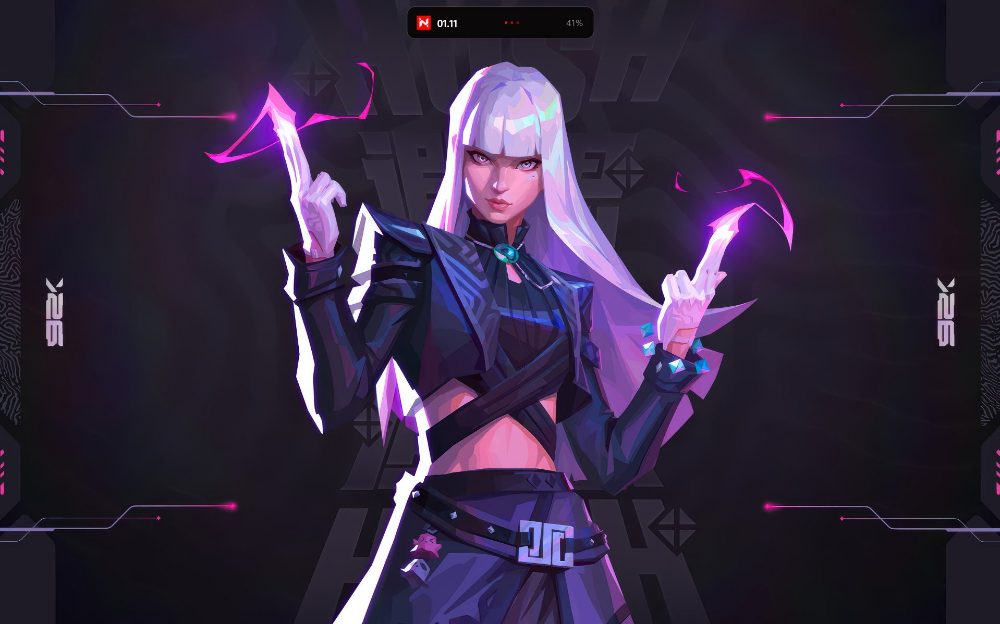
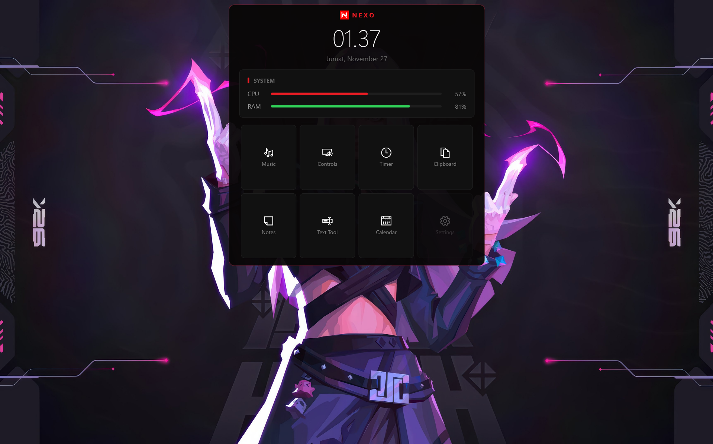
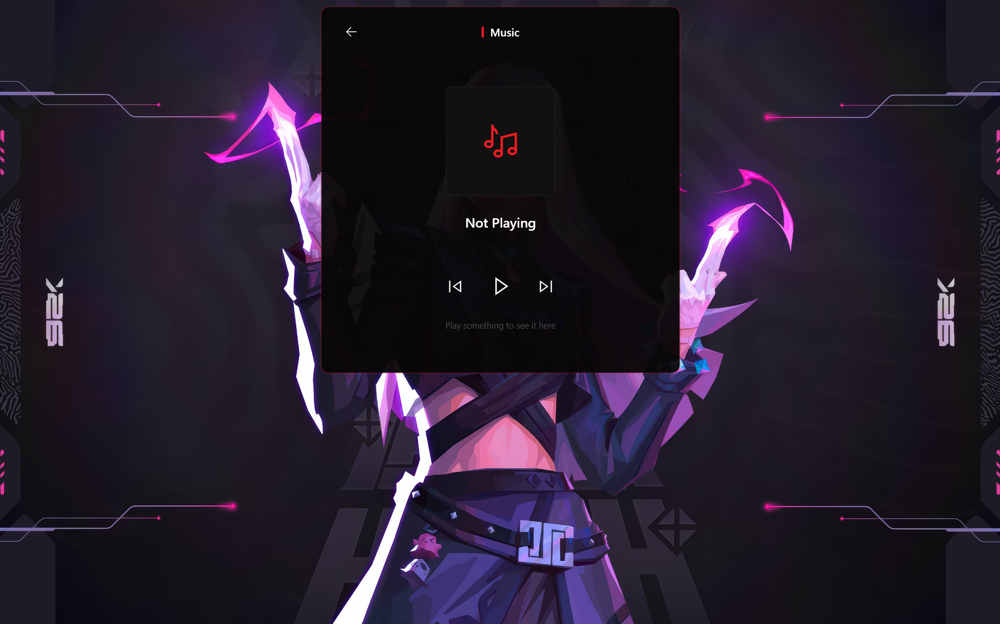
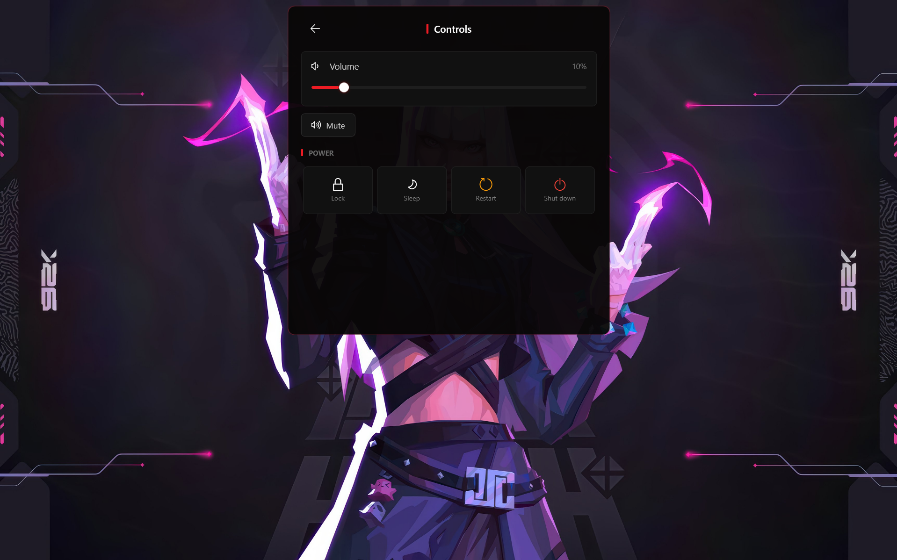

# 🚀 Nexo — Windows Dynamic Island

<div align="center">


**A modern, lightweight Dynamic Island for Windows inspired by AMD Software: Adrenalin Edition.**

[](https://microsoft.com/windows)
[](https://dotnet.microsoft.com/)
[](https://www.python.org/)
[](#license)

<br/>



<br/>

</div>

---

## 🌟 Highlights

**Nexo** menghadirkan pengalaman *Dynamic Island* yang halus dan intuitif di desktop Windows Anda. Didesain dengan estetika berani ala **AMD Adrenaline Edition** (tema gelap pekat `#060606`, aksen merah Radeon `#ED1C24`, dan panel angular modern), Nexo bertransisi mulus dari kapsul ringkas di atas layar menjadi dashboard produktivitas 2×4 yang lengkap.

---

## ✨ Fitur Utama

### 1. 🏝️ Context-Aware Compact Capsule
* Melayang di bagian atas layar monitor tanpa mengganggu aktivitas utama.
* **Context-aware status**:
  * Menampilkan jam & status CPU saat santai.
  * Menampilkan countdown `⏱ 14:59` saat timer aktif.
  * Menampilkan artis & lagu `♪ Artist` saat musik sedang diputar.
* Dilengkapi aksen merah khas Radeon dan animasi denyut pulse.
* Klik kapsul untuk memperluas (*expand*) ke mode dashboard dengan animasi fluida (350ms *CubicEase*).

### 2. 🎛️ Dashboard 2×4 Modules

| Modul | Ikon | Deskripsi |
|---|:---:|---|
| **Music** | 🎵 | Mengontrol media pemutar musik (Spotify, Chrome, YouTube, iTunes) via Windows SMTC (Play, Pause, Next, Prev, Title & Artist). |
| **Controls** | 🔊 | Slider volume audio Windows dengan respon real-time via Core Audio COM API + Kontrol Daya (Lock, Sleep, Restart, Shutdown). |
| **Timer & Stopwatch** | ⏱️ | Timer produktivitas dengan preset (5m, 10m, 15m, 25m Pomodoro, 30m) serta stopwatch milidetik. |
| **Clipboard History** | 📋 | Memonitor clipboard teks secara otomatis. Klik untuk langsung mem-paste, pin teks penting, dan hapus riwayat unpinned. |
| **Quick Notes** | 📝 | Notepad ringkas dengan fitur auto-save instan ke `%APPDATA%/Nexo/notes.txt`. |
| **Text Tool** | 🔤 | Alat pengolah teks instan: UPPERCASE, lowercase, Title Case, Word & Char Count, Format JSON Indent, serta Base64 Encode/Decode. |
| **Calendar** | 📅 | Kalender bulanan visual dengan navigasi bulan dan highlight hari ini. |
| **Settings** | ⚙️ | Pengaturan posisi, personalisasi, dan transparansi (tersedia untuk ekspansi berikutnya). |

### 3. 🖥️ Hardware Monitor Real-Time
* Memantau penggunaan **CPU (%)** dan **RAM (%)** secara akurat dan ringan menggunakan backend Python asynchronous via WebSocket IPC (1 Hz polling).

### 4. 🚀 Desktop App Tanpa Terminal
* Tidak perlu lagi membuka CMD atau PowerShell secara manual!
* Frontend C# otomatis menjalankan service Python di background tanpa jendela hitam (*silent background process*), dan otomatis mematikannya saat aplikasi ditutup.

---

## 🏗️ Arsitektur

```
┌────────────────────────────────────────────────────────┐
│                   Nexo.UI (C# WPF)                     │
│  - net8.0-windows10.0.19041.0 (WinRT SMTC & Audio API) │
│  - Adrenaline Style XAML + Fluent Animations           │
│  - Clipboard Listener (Win32 Hook)                     │
└──────────────────────────┬─────────────────────────────┘
                           │ WebSocket IPC (localhost:9123)
┌──────────────────────────▼─────────────────────────────┐
│               Nexo.Backend (Python)                    │
│  - Asyncio WebSocket Server                            │
│  - psutil System Telemetry (CPU & RAM)                 │
└────────────────────────────────────────────────────────┘
```

---

## 📦 Kebutuhan Sistem

* **OS:** Windows 10 (versi 19041 atau lebih baru) / Windows 11
* **Runtime:** [.NET 8.0 Desktop Runtime](https://dotnet.microsoft.com/download/dotnet/8.0)
* **Python:** [Python 3.11+](https://www.python.org/)

---

## 🚀 Panduan Menjalankan

### Cara Cepat (Pengguna):
Cukup **double-click** salah satu file berikut:
1. Shortcut **`Nexo`** di Desktop Anda.
2. File shortcut **`Nexo.lnk`** di folder root proyek.
3. Atau jalankan **`Run_Nexo.vbs`** untuk eksekusi tanpa jendela konsol.

### Cara Menjalankan dari Source Code (Developer):
```powershell
# Clone repositori
git clone https://github.com/aditya175-cyber/Nexo_App.git
cd Nexo_App

# Jalankan via startup script (otomatis setup venv & build)
powershell -ExecutionPolicy Bypass -File start.ps1
```

---

## 🎨 Kustomisasi Logo

Ingin menggunakan logo Anda sendiri?
1. Taruh file gambar logo Anda di:
   `src/WinIsland.UI/Assets/logo.png`
2. Double-click file helper:
   **`update_logo.bat`**
   *(Script otomatis mengonversi PNG ke format multi-resolusi `.ico` Windows dan me-rebuild aplikasi).*

---

## 🛠️ Struktur Direktori

```
d:\Nexo\
├── Nexo.sln                    # Visual Studio Solution
├── start.ps1                   # Launcher & setup script otomatis
├── Run_Nexo.vbs                # Silent VBScript launcher
├── update_logo.bat             # 1-Click logo converter & builder
├── convert_logo.py             # Script konversi gambar ke multi-size ICO
├── create_shortcuts.ps1        # Script pembuat shortcut Desktop
├── README.md                   # Dokumentasi proyek
├── .gitignore                  # Git ignore rules
├── src/
│   ├── WinIsland.UI/           # C# WPF Frontend
│   │   ├── Assets/             # Icon (app.ico) & Logo (logo.png)
│   │   ├── Models/             # ClipboardItem, CalendarDay
│   │   ├── Services/           # AudioService, MediaService, SystemService, WebSocketClient, BackendService
│   │   ├── ViewModels/         # IslandViewModel (MVVM)
│   │   └── Views/              # IslandWindow.xaml (AMD Adrenaline layout)
│   └── WinIsland.Backend/      # Python Backend
│       ├── core/               # WebSocket IPC Server
│       ├── modules/            # System hardware monitor (psutil)
│       ├── main.py             # Entrypoint backend
│       └── requirements.txt    # websockets, psutil, pillow
```

---

## 📄 Lisensi

Proyek ini dilisensikan di bawah lisensi **MIT**. Silakan gunakan dan kembangkan sesuai kebutuhan Anda.
